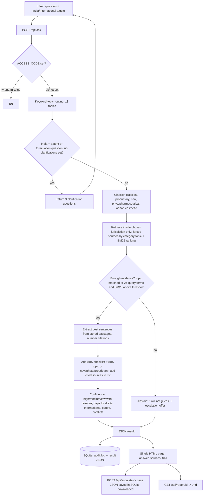

# Architecture

## Language layer
`i18n.py` expands Devanagari questions with English search terms before routing and BM25, then localises the response (UI strings, reasons, notes, Hindi summaries from `corpus_hi.py`). The audit log, report and case file stay English.

## Components
- `corpus.py`: 33 hand-written summaries (23 India, 10 International) with verification metadata. Single source of truth for passages.
- `app.py`: topic routing, a small BM25 (k1=1.5, b=0.75, light plural stemming, one index per jurisdiction), answer assembly, confidence rules, Flask routes, SQLite.
- `static/index.html`: one page, no external resources.
- `eval.py`: 23 development tests via Flask's test client.

## Design rules enforced in code
- Each jurisdiction has its own BM25 index and candidate pool; `build_answer` asserts every source matches the chosen jurisdiction.
- Answers are sentences copied from stored summaries, never generated text.
- Every citation number maps to a source in the list; ABS checklist sources are appended to the list if missing.
- Confidence is a level plus reasons. No numeric score.
